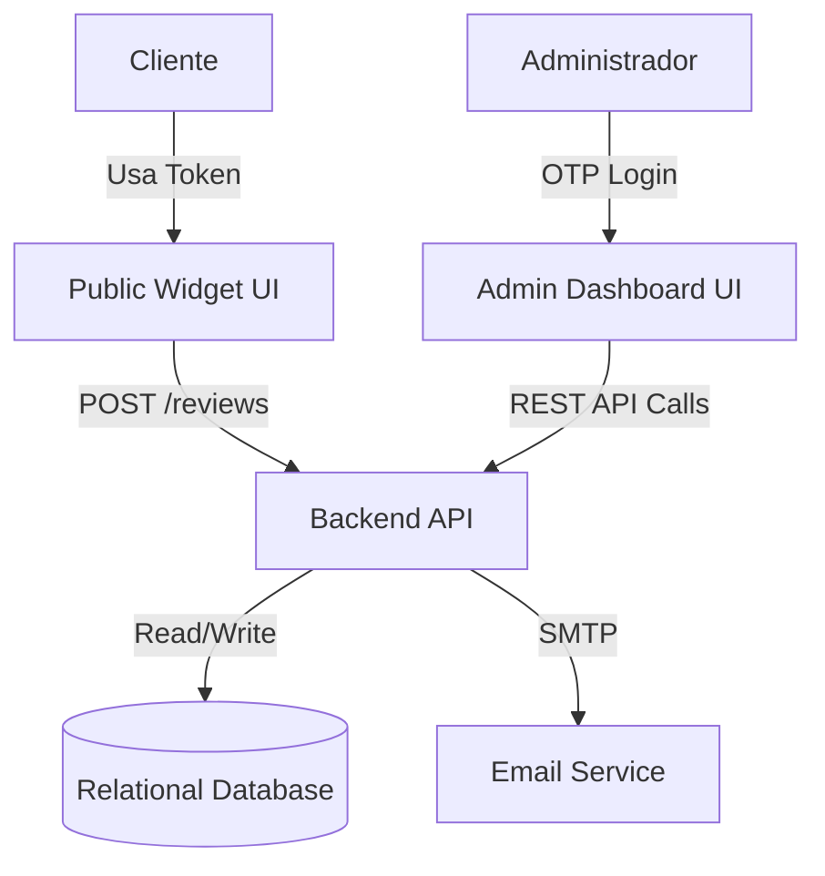

# System Architecture

## High-Level Overview
The Engine Review System is divided into two main interfaces:
1. **Public Widget**: A lightweight, parameter-driven frontend for customers to submit reviews via unique tokens.
2. **Admin Dashboard**: A secure, authenticated portal for administrators to manage tokens, moderate reviews, and configure the system.

## Component Diagram

